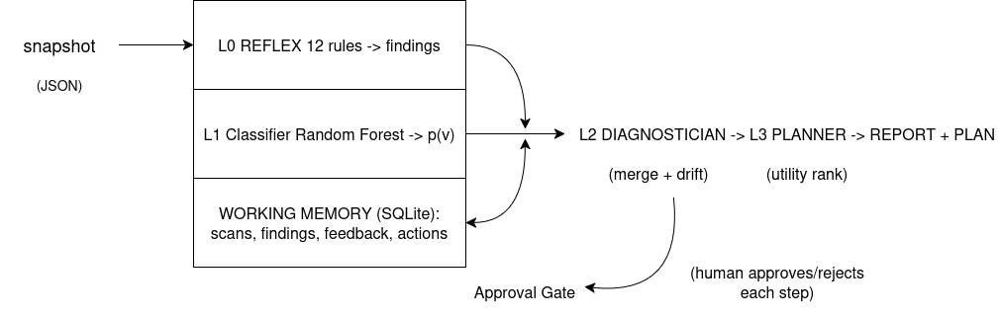

# AutoSecure

[](https://github.com/deltaSentinel/autoSecure/actions/workflows/ci.yml/badge.svg)

[](./LICENSE)
[](./SECURITY.md)

AI-driven vulnerability and misconfiguration detection for personal computing environments — a four-layer hybrid agent combining hand-written reflex rules with a learned classifier. Developed as a semester project for AI-472.

**Team:** Raymond Balesky (EE/CPE) · Kayla Granger (Computer Science)

**Ethics note:** AutoSecure is intended for hosts you own or are explicitly authorized to test. Mutation mode (`--act`) requires root *and* an explicit human approval for every proposed fix. See [Responsible use](#responsible-use).

---

## What this is

AutoSecure scans a Linux host's configuration posture — SSH settings, file permissions, user accounts, firewall state, listening services — classifies the host as *clean* or *misconfigured* using a Random Forest over 25 normalized features, and proposes a utility-ranked, reversible remediation plan behind a human approval gate.

### Headline results

| Result (out-of-fold, 5-fold stratified CV, n=580) | Value |
|---|---|
| L1 classifier: Precision / Recall / F1 / ROC-AUC | 0.990 / 0.949 / 0.969 / 0.977 (4 FP, 22 FN) |
| HYBRID (L0 ∪ L1): Precision / Recall / F1 | 0.991 / 0.974 / 0.982 (4 FP, 11 FN) |
| Hybrid vs. classifier-only at strict threshold (t=0.95) | F1 **0.973 vs 0.817** |
| Calibration (Platt sigmoid) | Brier 0.0506 → 0.0416; default-threshold F1 0.982 hybrid vs 0.969 L1-only |

Figures reflect the FIX [3]-paired dataset (Nov 2026): clean baselines now draw the Debian-default `prohibit-password`, so `risk_ssh_permit_root_login` is no longer a free discriminator for L1. See [Dataset provenance](#dataset-provenance). The hybrid gains relative importance at the same time — the reflex layer absorbs what L1 now weighs more cautiously (hybrid recall 0.974 > L1 0.949).

The threshold-sweep result is the core architectural claim: the hand-written rule layer acts as **threshold-invariant recall insurance**, which is what justifies the hybrid design at strict operating points. Post-pairing, M01 is the sharpest example: a lone M01 host is *indistinguishable from a clean Debian host in feature space* (both carry `risk_ssh_permit_root_login = 1`), so L1 catches only 2/12 M01 singles out-of-fold — the raw `"yes"` value that separates them is readable only by reflex rule R13. The layers cover complementary evidence by construction.

### Architecture



| Layer | Function | Type (Russell & Norvig) |
|-------|----------|-------------------------|
| L0 — Reflex | 12 deterministic condition→finding rules | Simple reflex |
| L1 — Classifier | Random Forest, 25-feature vector | Model-based |
| L2 — Diagnostician | Merges L0+L1 findings, drift attribution vs. prior scans | Internal state |
| L3 — Planner | Utility-ranked fixes: `severity − disruption − fp_penalty` | Utility-based |

**Safety invariants:** read-only unless `--act` is passed; `--act` requires root and hard-refuses otherwise (no silent degradation); every finding is evidence-chained; operator rejections persist and lower that rule's utility in future runs.

## Quick start

Python 3.12, managed with [`uv`](https://docs.astral.sh/uv/). Everything else is stdlib. Whole pipeline runs offline — no GPU, no special hardware.

```bash
git clone https://github.com/deltaSentinel/autoSecure.git
cd autoSecure
uv venv && uv pip install scikit-learn joblib numpy pytest

# Scan a snapshot (read-only by default)
uv run python3 agent/main.py --snapshot <path/to/snapshot.json> --db agent/mem.db
```

Mutation mode adds `--act` (requires root; refuses otherwise)

The full pipeline (dataset generation → training → experiments) is documented in [Canonical commands](#canonical-commands) below.

## Directory layout

Grouped by *where code executes* — everything under `collector/` runs on target hosts; everything else stays at the desk. Generated artifacts live under `reports/`, keyed by which stage produced them.

```
autoSecure/
├── agent/            # main.py (four-layer harness) + mem.db runtime state
├── collector/         # collect.py (+ PowerShell port), inject.sh, checks.py, backends.py
│                     #   CONTRACT.md, README-collector.md, README-windows.md
├── experiments/       # synth_dataset.py, gen_dataset.py, gen_real_data.sh,
│                     #   arb_experiment.py, planner_sweep.py
├── train/            # train.py, eval_holdout.py; agent model drop point
├── data/
│   ├── synth/         # 580 synthetic training snapshots (regenerable — seed 7;
│   │                  #   NOT version-controlled)
│   └── real/          # real LXC snapshots (break phase) — NEVER mixed with synth
├── models/            # model.joblib, feature_keys.json, importances.csv,
│                      #   planner_coeffs.json (sweep-learned planner
│                      #   defaults; machine-specific, gitignored)
│                      #   (deployment artifacts only — experiment reports
│                      #   never go here)
├── reports/
│   ├── training/      # eval_report.md + eval_report.pre-fix3.md (pre-FIX [3]
│   │                  #   baseline); history/ is local-only (untracked)
│   ├── experiments/   # arbitration_report.md, planner_report.md,
│   │                  #   threshold_sweep.csv, planner_sweep.csv + history/
│   │                  #   (untracked)
│   └── scans/         # agent scan reports (Markdown; timestamped output untracked)
├── Presentations/     # decks, demo material, Images/Diagrams, Images/Graphs
├── tests/             # pytest suite: rules catalog, R16 drift, artifact sync,
│                      #   synth pairing guard + fixtures
├── LICENSE            # BSD-3-Clause
├── SECURITY.md        # vulnerability reporting policy
└── README.md          # this file
```

The test suite includes per-rule known-positive/negative coverage, a `test_artifacts_synced.py` guard so committed reports can't silently drift from the code that generates them, `test_planner_coeffs.py` covering the learned-coefficient loader, CLI override order, and the small-sample guard, and `test_synth_pairing.py`, which imports the collector's `PermitRootLogin` risk map directly and asserts every synthetic snapshot's `features_ml` is derivable from its `features_raw`.

## Environment

Python 3.12, managed with `uv`. From the project root:

```bash
uv venv && uv pip install scikit-learn joblib numpy pytest
```

Everything else is stdlib. Whole pipeline runs offline. No GPU, no special hardware.

## Canonical commands

All commands run from the project root unless noted.

**Regenerate the synthetic training set** (seed 7 ⇒ bit-identical reproduction):

```bash
uv run python3 experiments/synth_dataset.py --out data/synth --clean 150 --singles 12 --combos 250 --seed 7
ls data/synth/*.json | wc -l   # MUST be 580 — verify after EVERY generation
```

The generator **appends**: never run it into a non-empty `data/synth/` unless you intend duplication (duplicated snapshots invalidate out-of-fold CV; see *Dataset provenance* below).

After any change to the generator, also run `uv run pytest tests/test_synth_pairing.py` — it catches datasets where `features_ml` disagrees with `features_raw` (a state no real collector can produce) and where the clean-baseline value pool has silently regressed.

**Train:**

```bash
uv run python3 train/train.py --dataset data/synth --out models
```

Exports `model.joblib`, `feature_keys.json`, `importances.csv`, and writes evaluation artifacts under `reports/training/`. Metrics are out-of-fold (5-fold stratified CV).

**Arbitration experiment (L0 vs L1 vs hybrid, with threshold sweep):**

```bash
uv run python3 experiments/arb_experiment.py --dataset data/synth --out reports/experiments --sweep
```

Imports `evaluate_reflex` directly from `agent/main.py` — the experiment and the deployed agent share one rule catalog by construction. (Note: `--out reports/experiments` is explicit on purpose — the model export directory `models/` must contain deployment artifacts only.)

**Planner utility sweep**:

```bash
# synthetic mode (regression/CI; never writes learned coefficients)
uv run python3 experiments/planner_sweep.py --out reports/experiments

# real-feedback mode: rank the grid against operator approve/reject
# tuples in mem.db and persist winners to models/planner_coeffs.json
uv run python3 experiments/planner_sweep.py --db agent/mem.db \
    --objective approved_utility --out reports/experiments
```

**Real-data transfer test** (break phase — run from inside `train/`):

```bash
cd train && uv run python3 eval_holdout.py ../data/real && cd ..
```

Note: `eval_holdout.py` resolves `../models/` relative to its own location, so it must be launched from `train/`.

**On-target data collection** (inside a disposable LXC/VM, as root):

```bash
python3 /root/collect.py --host-id <id> --tag <tag> --label <clean|vulnerable> [--inject M01 ...] --out <dir>
```

## Dataset provenance

- **Synthetic set:** 580 snapshots = 150 clean + 180 singles (15 misconfig types × 12) + 250 random 2–4-misconfig combinations, across desktop/server/minimal host profiles. Generated with `--seed 7`; fully reproducible, therefore *not* version-controlled.
- **Dataset:** the 30% password-auth clean-baseline noise and the 50/50 no/prohibit-password permit-root-login draw are deliberate realism, retained through the label-collision fix and FIX [3]. The M02 raw-mirroring fix restores raw/ML consistency for tagged M02 samples without touching either noise channel or the RNG stream (host mix and L1 metrics reproduce exactly).
- **Label-collision fix (Nov 2026):** clean baselines originally carried strict-risk noise (firewall-down ~25%, weak password policy ~15%, etc.) identical to injected misconfig signatures, making five misconfig types unlearnable (recall 0.847). Strict-risk noise was removed from clean baselines; debatable soft risks (password auth ~30%, fail2ban absent ~80%) deliberately retained.
- **FIX [3] pairing (Nov 2026):** the collector scores `prohibit-password` — the Debian default — as a root-login risk (it previously scored 0 via a truthiness bug, a blind spot for the M01 attack surface). The generator's clean baselines now draw `permit_root_login` from `{"no", "prohibit-password"}` (~46% carry the Debian default) with `features_ml` synced accordingly, so L1 can no longer treat `risk_ssh_permit_root_login` as a free discriminator. Cost of honesty: L1 solo recall 0.970 → 0.949, clean-class precision 0.92 → 0.87, and lone-M01 hosts become feature-space-identical to clean Debian hosts (2/12 caught by L1 out-of-fold). Payoff: HYBRID recall 0.972 → 0.974 at unchanged F1 0.982, the model no longer expects every Debian host to be compromised, and the division of labor between reflex rules (raw values) and classifier (aggregated features) is now structurally demonstrated. Consistency is enforced by `tests/test_synth_pairing.py`; pre-change metrics are preserved in `reports/training/eval_report.pre-fix3.md`.
- **Real set (pending):** snapshots from disposable Proxmox LXC clones on HWHS-001; destroy-instead-of-revert guarantees zero residue. Train/test separation is mandatory and structural: synth trains, real tests.

## Model / agent contract

The vectorization contract is **law**, enforced by `models/feature_keys.json`:

1. Feature source: snapshot's `features_ml` dict
2. Key order: **alphabetically sorted**
3. Missing/`null` features: masked to **0.0**
4. Orientation: all `risk_*` features oriented so **1 = insecure**

## Limitations

Stating limits up front is deliberate: a security tool that can't articulate its blind spots is a liability.

- **M02 (SSH password auth) is intentionally blurred.** Clean baselines retain password-auth noise (~30%), so the model cannot fully separate M02 from clean hosts: 1 of 12 M02 hosts missed out-of-fold. Kept deliberately to mirror real-world ambiguity; see `reports/training/eval_report.md`.
- - **M02 (PasswordAuthentication yes) lone singles are L1-blind by retained design.** Roughly 30% of clean baselines deliberately draw the password-auth flag (raw/ML paired), so the lone-M02 feature vector is genuinely ambiguous; the classifier correctly learns that password-auth alone does not convict and catches 1/12 singles out-of-fold. All M02-containing combos are caught by L1. The hybrid covers the gap: R07 reads the raw value directly, giving 12/12 lone-M02 recall system-wide after the M02 raw-mirroring fix. Symmetric cost: R07 also fires on the ~30% noisy-clean baselines, and a lone R07 hit sits at composite risk 0.503, just over the action threshold. Recovery of L1 single-tag recall is deferred (option C: correlation features), to be informed by break-phase real data.
- **M01 is undetectable by L1 alone (by design).** Since the FIX [3] pairing, a lone M01 host and a clean Debian-default host carry the *identical* ML feature vector — the distinguishing information (`"yes"` vs `"prohibit-password"`) exists only in `features_raw`, which only reflex rule R13 reads. L1 therefore catches 2/12 M01 singles out-of-fold; the hybrid design exists precisely for this. This is the cost of an honest baseline: the model cannot both learn "root login allowed is normal on Debian" and "root login allowed is an incident" from the same scalar.
- **Trained and evaluated on synthetic data.** Real-host performance is expected to differ — we have a registered prediction that default-threshold layer nesting breaks on real hosts (clean machines carry out-of-catalog misconfigurations). The break-phase transfer test will resolve this.
- **Calibration and threshold choice materially change the operating point:** Platt calibration improves the Brier score 0.0506 → 0.0416, and at t=0.95 the classifier-only F1 falls to 0.817 while the hybrid holds 0.973. The reflex layer is what keeps the hybrid stable across thresholds.
- **Configuration posture only.** Not a network vulnerability scanner, IDS, or antivirus.

## Known pitfalls (institutional memory)

<details>
<summary>Internal team notes — expand if you're contributing</summary>

1. **The generator appends.** Verify `ls data/synth/*.json | wc -l == 580` after every run. Duplicates silently inflate out-of-fold metrics (twin-in-fold leakage).
2. **Relative paths assume project root** (except `eval_holdout.py`, which assumes `train/`).
3. **Multiline pastes break `\` continuations**: treat every documented command as single-line.
4. **`arb_experiment.py`'s agent-dir default** is `../agent` relative to `experiments/`; if the script moves again, a sed or manual change must be made. Likewise always pass `--out reports/experiments` explicitly — its output never belongs in `models/`.
5. **Throwaway runs pollute `reports/scans/`.** The agent's `--report` defaults into the repo tree even when `--db` points at `/tmp`. Any smoke or test run must pass BOTH flags (`--db /tmp/x.db --report /tmp/x.md`); a fresh DB also restarts scan numbering at 1, so repeated throwaway runs accumulate near-duplicate `report_<host>_scan1_<stamp>.md` files. Timestamped scan reports are now gitignored, but still clean them out periodically.
6. **`planner_sweep.py` `--out` default** is anchored to the script location (`<repo>/reports/experiments` from anywhere), no longer cwd-relative. Still pass `--out` explicitly when piping reports elsewhere. Real mode (`--db`) opens the feedback DB read-only, so it can never mutate operator data.
7. **A typo'd assignment is a silent no-op, and metrics won't save you.** During the FIX [3] pairing, two patch attempts (`==` instead of `=`, ml entry under a misspelled key) produced *healthy-looking* metrics while the dataset was unchanged or internally impossible — both caught only by inspecting raw values (`grep -h '"permit_root_login"' data/synth/*.json | sort | uniq -c`). After touching the generator: eyeball the `git diff` for `=`/`==` and bare statements, then run `tests/test_synth_pairing.py`. Identical metrics across a "changed" dataset are a failure signal, not stability.
8. **`models/planner_coeffs.json` is machine-specific**: it embeds an absolute db path and per-operator feedback counts, so it is gitignored and must be reswept per deployment. Also note: report-assembly code that only runs on failure branches (guard trips, empty candidate sets) is only ever exercised by the tests that trigger those branches. Coverage of the branch, not the line count, is what catches `append`/`extend` slips.
</details>

## Status & next steps

- [x] Collector + 15-misconfig injection catalog (reversible, manifest-tracked)
- [x] Synthetic dataset generator (seeded, three-tier, collision-safe)
- [x] Training pipeline + evaluation artifacts
- [x] Four-layer agent with memory, feedback loop, and approval gate
- [x] Arbitration + threshold-sweep experiments
- [x] Progress presentation
- [x] Probability calibration for L1 (Platt scaling, threshold sweep to set operating point)
- [x] FIX [3] paired: Debian-default `PermitRootLogin` in clean baselines + ml/raw consistency regression guard
- [ ] Break phase: real dataset via Proxmox LXC clone loop (`gen_dataset.py` / pct workflow)
- [ ] Transfer test (`eval_holdout.py`) + arbitration rerun on real data
- [x] Rule extension R13–R15 (blind-spot-driven: PermitRootLogin, world-writable dirs, world-writable /etc)
- [x] Planner coefficient learning (issue #8): sweep runs against real operator feedback, persists winning beta/gamma, agent loads them as defaults
- [ ] Final report + presentation

## Roadmap

**Tier 1**
- [x] R13–R16 remediation paths: each needs a remediation entry. Decisions to make: idempotency (rerun fix after partial fix), verification (rescan to confirm cleared), and per-backend command indirection for system agnosticism.
- [x] Pytest regression suite: formalized echo test with `tests/` dir, a known positive and negative per rule ID.
- [x] Utility coefficient tuning: currently hand-set. Collect labeled sets of tuples and fit coefficients against outcomes.

**Tier 2**
- [ ] Real-data retraining and hybrid datasets: after break-phase training, see if hybrid real/synth changes results. Also allows better setting of synth data generation.
- [ ] Smarter arbitration: union and intersect only go so far — a middle ground with weighted fusion (severity-modulated thresholds).
- [ ] Drift detection: "posture trend line" to show how posture improves/degrades.
- [ ] Multi-host: extend planner for multiple hosts.
- [ ] Second collector backend (dnf/rpm): set up agnosticism for data collection.
- [ ] Benchmark vs. scanner: verify results against Lynis or OpenSCAP to compare and prove validity.
- [ ] If more data becomes available, consider switching from Platt scaling to isotonic regression (currently it would overfit).

**Tier 3**
- [ ] Adversarial evasion analysis: study if feature perturbations can mask a signature.
- [ ] Active data collection: agent chooses what is scanned next, given current belief state, which probe or target maximizes expected information gain about the fleet.
- [ ] Learned rule generation: mine only-L1 samples' features for predicates and propose rules automatically.
- [ ] Counterfactual explanations: for each L1 fire, compute the minimal feature change to flip the verdict.
- [ ] Distribution-shift monitoring: measure synth → real drift and track it as more real data is collected.

## References

- Russell, S. & Norvig, P. — *Artificial Intelligence: A Modern Approach*, Ch. 2 (agent taxonomy)
- Project artifacts: `reports/training/eval_report.md`, `reports/experiments/arbitration_report.md`, `reports/experiments/planner_report.md`, `Presentations/`

## License

Released under the **BSD-3-Clause License** see [LICENSE](./LICENSE).

## Responsible use

**Run AutoSecure only against systems you own or are explicitly authorized to test**: your own lab, a class environment, or infrastructure with written permission. The collector's misconfiguration injection (`collector/inject.sh`) deliberately breaks configurations; never point it at a production or third-party host.

The agent is read-only by default. Even in `--act` mode, nothing executes without explicit human approval at the gate — but always review a proposed remediation plan before approving it.

Found a security issue in AutoSecure itself? Please report it privately — see [SECURITY.md](./SECURITY.md), not a public issue.

